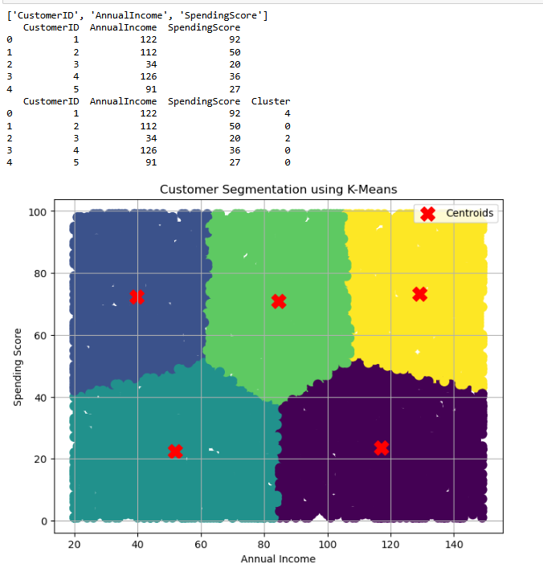

# Exp 02 K-Means Clustering
**Date:** 06-11-2026

## AIM:
To implement the K-Means Clustering algorithm in Python to group customers based on their Annual Income and Spending Score and visualize the clusters using a scatter plot.

## DESIGN STEPS:

**Step 1:**  
Clone the repository from GitHub.

**Step 2:**  
Create a Python project in the preferred IDE (VS Code/PyCharm/Jupyter Notebook).

**Step 3:**  
Create the Python program for K-Means Clustering using the Scikit-learn library.

**Step 4:**  
Load the customer dataset and select the features **Annual Income** and **Spending Score**.

**Step 5:**  
Create the K-Means model by specifying the required number of clusters.

**Step 6:**  
Train the model and assign each customer to the nearest cluster.

**Step 7:**  
Visualize the clusters and their centroids using a scatter plot.

**Step 8:**  
Execute the program and verify the clustered output.

## PROGRAM:

```
import pandas as pd
import matplotlib.pyplot as plt
from sklearn.cluster import KMeans

data = pd.read_csv(r"customers_large_dataset.csv")

print(data.columns.tolist())
print(data.head())

X = data[['AnnualIncome', 'SpendingScore']]

kmeans = KMeans(n_clusters=5)

data['Cluster'] = kmeans.fit_predict(X)

print(data.head())

plt.figure(figsize=(8,6))

plt.scatter(
    data['AnnualIncome'],
    data['SpendingScore'],
    c=data['Cluster'],
    cmap='viridis',
    s=80
)

plt.scatter(
    kmeans.cluster_centers_[:,0],
    kmeans.cluster_centers_[:,1],
    color='red',
    marker='X',
    s=200,
    label='Centroids'
)

plt.xlabel("Annual Income")
plt.ylabel("Spending Score")
plt.title("Customer Segmentation using K-Means")
plt.legend()
plt.grid(True)
plt.show()
```

## OUTPUT:



## RESULT:

The K-Means Clustering algorithm was implemented successfully, and the customers were grouped into clusters based on their Annual Income and Spending Score. The resulting clusters were visualized using a scatter plot.
